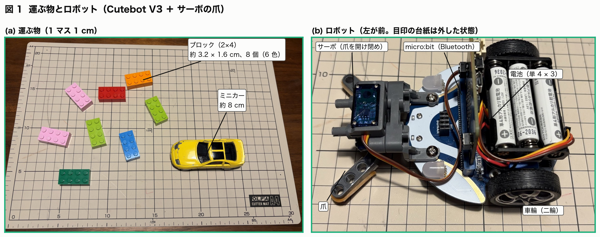
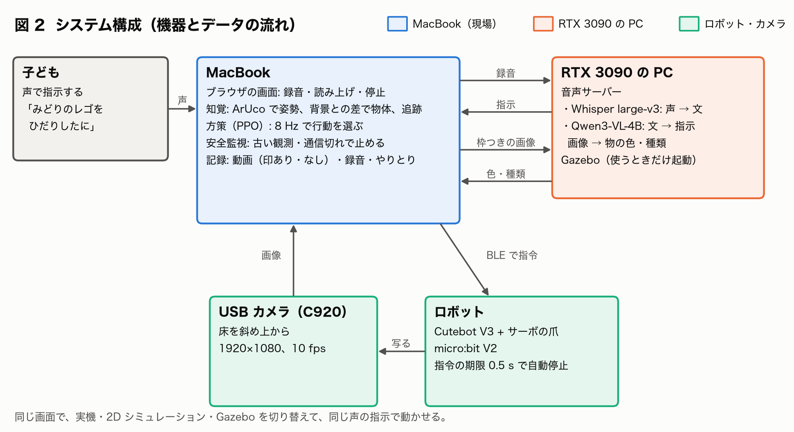
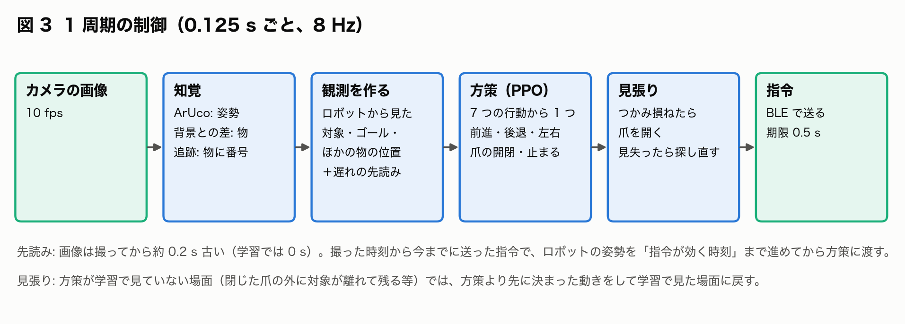
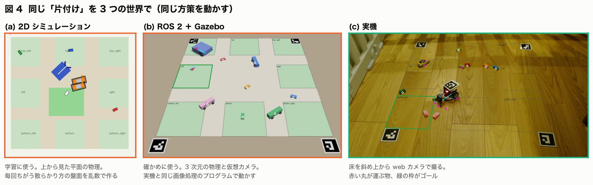
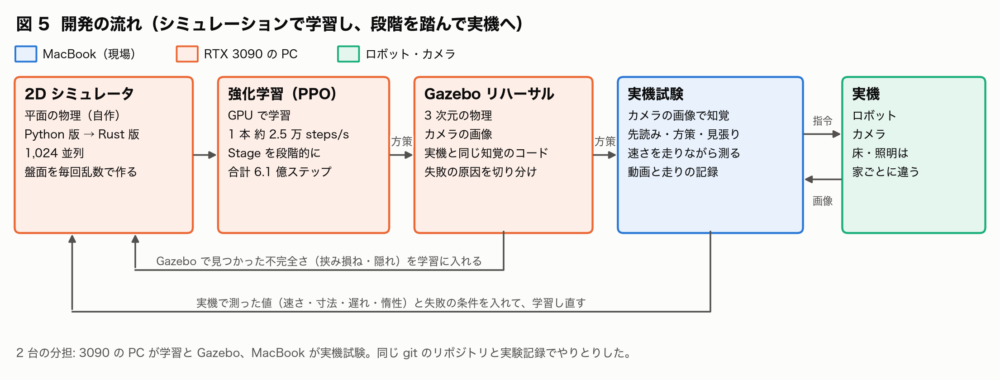
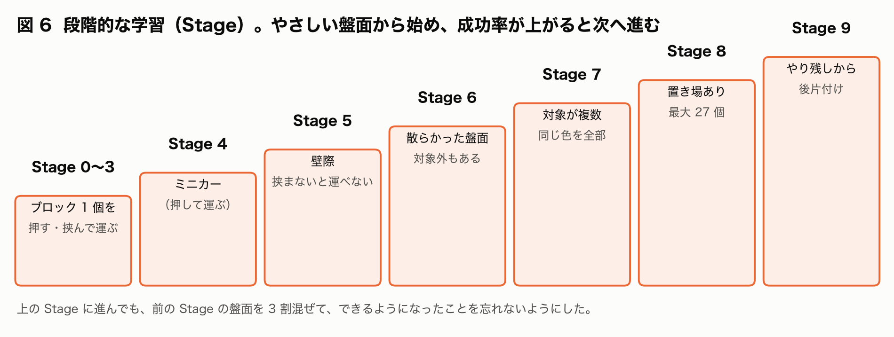

# AI Toy Sweeper — 話しかけるとおもちゃを片付けるロボット

Physical AI 応用編1 最終課題 レポート

本文の「ブロック」はおもちゃの組み立てブロック（LEGO® など）を指す。LEGO は LEGO Group の商標である。子どもが実際に言った
言葉（「みどりのレゴを…」）は言ったまま引用した。

---

## 1. 背景と問題意識

小さな子どもは遊んだおもちゃを床に散らかしたまま、なかなか片付けない。「片付けなさい」と言われても片付けは楽しくない。

もし子どもが「みどりのブロックをあそこにかたづけて」と話しかけるだけでロボットが片付けてくれるなら、片付けは「ロボットに
頼む遊び」になる。どの色をどこへ運ばせるかを子どもが考えて言うので、子ども自身も片付けに参加できる。

近年の AI はこれを可能にしつつある。音声認識を使えば子どもの声を文字にできるので、ボタンやプログラムを覚えなくても使える。
画像と言葉を両方扱える大規模言語モデル（VLM）を使えば、「赤いのは右上ね」「ミニカーはそのままでブロックだけ」のような自由な
言い方をロボットの指示に直せる。決まった命令の一覧を用意する必要がない。押す・挟む・回り込むといった体の動かし方は、強化学習で
シミュレーションの中で何百万回も試行錯誤させれば身につけさせられる。

## 2. 概要と目的

### 2.1 作ったもの

床に散らかったブロックとミニカーを、子どもが声で言った指示どおりに片付ける小型ロボットを作った。

たとえば子どもが「みどりのレゴを ひだりしたに かたづけて」と言うと、次のように動く。

1. 声を文字にして「緑のブロックを床の左下の場所へ」という指示に直す。
2. 床を斜め上から撮るカメラの画像から、床の上の物とロボットの位置・向きを求める。
3. 見つけた物のうちどれが緑のブロックかを、画像から見分ける。
4. ロボットが緑のブロックに近づいて爪で挟み、左下の場所まで運んで置く。置いたら少し下がって、本当に入ったかを確かめる。
5. 終わったら「できたよ！ みどりの レゴを ぜんぶ ひだりしたに はこんだよ」と声で答える。

ロボットは市販の安価な教育用の二輪ロボット（Cutebot V3、手のひら大）に、物を挟むサーボの爪を付けたものである。観測用のセンサーは USB の web カメラ 1 台だけである。計算はロボットの上ではなく、ノートパソコン（MacBook）と GPU を積んだ PC（RTX 3090）で行う。
ロボットには無線（Bluetooth）で 1 秒に 8 回、「前へ」「右へ回る」「爪を閉じる」などの指令を送る。

運ぶ物は 2×4 のブロック（約 3.2 × 1.6 cm、高さ約 1.1 cm、6 色）とミニカー（約 8 cm）である。ロボットの前には爪が付いていて、
サーボで開け閉めする。実機ではロボットの上に、位置と向きを読むための白黒の目印（ArUco マーカーの台紙）を付けて動かす。
写真ではこの台紙を外している。

### 2.2 目的

目的は次の 3 つである。

1. 家庭の床で、言葉で頼むだけで片付けが進むことを実機で示す。家庭の床は物の置き方も照明も毎回違うので、決まった手順を書いて
   おくやり方では対応しきれない。学習で身につけた動き方と、画像と言葉を理解する AI を組み合わせる。
2. 音声認識・VLM・強化学習の方策を組み合わせ、実機で動くシステムとしてつなげる。声を聞いて言葉を理解し、物を見分けて
   動き方を決め、ロボットを動かす。動いた結果はカメラで見て次の動きに反映し、この判断を 1 秒に 8 回くり返す。
3. 安価な機材で、シミュレーションで学習した動き方を実機に移す（sim2real）。実機で何万回も試すことはできないので、学習は
   コンピュータの中のシミュレーションで行う。

### 2.3 方針: 精度の限界を前提にして、ノイズに強い方策を育てる

ありあわせの web カメラと安価な教育用ロボットを使うので、位置の読み取りと動作の精度には限界がある。
カメラは斜めからの 1 台なので物同士が重なって見え、ロボット自身の陰にも物が隠れる。ロボットは電池の残りでも動きが変わり、左右の車輪の速さも違う。

そこで、精度の高い機材や細かい調整で誤差を消すのではなく、誤差がある前提で動ける方策を学習する方針をとった。シミュレーション
には実機で起こりうる誤差（位置の読み違い、見えない時間、つかみ損ね、指令の遅れ、速さのばらつき）を大きめに乱数で入れて学習
させた（ドメインランダム化）。それでも残る差は、実機で測っては学習に戻すことをくり返して埋めつつ、状況を確認して再トライする設計でカバーした。実際に動かして
みると、シミュレーションと実機の差は想像以上に多かったため、その一つ一つを観察して埋めていく作業が、開発の中心になった。

## 3. 設計

### 3.1 役割の分け方

「何をどこへ運ぶか」と「どう動くか」を別の AI に任せた。

「何をどこへ」は、言葉と画像の理解である。ここには VLM（Qwen3-VL-4B）と音声認識（Whisper large-v3）を使った。子どもの言い方は
自由なので、学習済みの基盤モデルが向いている。

「どう動くか」は体の動かし方である。ここには強化学習で育てた方策（policy）を使った。方策とは、いまの状況を受け取って次の行動を
1 つ選ぶプログラムのことである。強化学習では、シミュレーションの中で何百万回も試させ、うまくいったら点（報酬）を与える。形状の異なる複数種類の物体を押す・挟む・回り込むといった細かい動きは、言葉で
書き下すより試行錯誤で身につけさせる方が向いている。学習アルゴリズムにはPPOを使用した。

部品に分けたもう一つの理由は、計算資源の限界である。理想は、カメラの画像と子どもの言葉を 1 つの大きなモデルに入れて、そのまま
ロボットの動作を出す形（VLA: Vision-Language-Action モデルによるE2E）だった。しかし使える計算機は、現場の MacBook（CPU）と GPU を積んだ
PC 1 台だけである。大きなモデルを 1 秒に 8 回動かすのも、ロボットの動作のデータを大量に集めて学習させるのも難しい。そこで処理を
部品に分け、それぞれを手元の計算資源で動く大きさにして組み合わせた。

| 部品 | 動かす場所と頻度 | 重さ |
|---|---|---|
| 音声認識（Whisper large-v3）と VLM（Qwen3-VL-4B） | GPU の PC で、指示を受けたときと物を見分け直すときだけ | 重い（1 回 1〜4 秒） |
| 画像処理（目印・背景との差・追跡） | MacBook の CPU で 1 秒 10 枚 | 軽い（1 枚 約 40 ms） |
| 方策（強化学習） | MacBook の CPU で 1 秒 8 回 | とても軽い（1 回 約 1 ms） |

分けたおかげで、言葉の理解だけ、方策だけ、と部品ごとに確かめられた（5.3 の切り分け）。一方で部品のつなぎ目では失敗が起きやすく、
たとえば VLM が見分けた物と追跡している物の対応がずれることがあった。その手当てに多くの時間を使った。

### 3.2 機器とデータの流れ

MacBook は現場の計算機で、ブラウザの画面（録音ボタン・読み上げ・停止ボタン）、カメラの画像の処理、方策の実行、ロボットへの指令を
受け持つ。RTX 3090 の PC は、GPU が要る声の書き起こしと VLM を受け持つ。学習と Gazebo（3.4）もこの PC で行った。

カメラは床を斜め上から撮る 1 台である（1920×1080 画素、1 秒 10 枚）。ロボットは Cutebot V3 にサーボの爪と micro:bit V2（小さな
マイコン）を載せたもので、指令には 0.5 秒の期限を付けてある。指令が届かなくなるとロボット自身が止まる。

### 3.3 1 回の判断の流れ（0.125 秒ごと）

まず画像から位置を求める（知覚）。ロボットの位置と向きは、ロボットの上に貼った白黒の目印（ArUco マーカー）から求める。物は「背景との差」で見つける。何も置いていない床を先に撮っておき、それと色が違う所を物とみなす方法である。
同じ物には同じ番号を付け続けて（追跡）、少し隠れても見失わないようにした。床の 4 隅にも目印を置いておき、画像の点を床の上の
位置（cm）に直せるよう校正を事前に行う。

方策には画像そのものではなく、「ロボットから見て運ぶ物は右前 20 cm、ゴールは左後ろ 40 cm、ほかの物はここ」という数字の並び
（観測）を渡す。この形ならシミュレーションでも実機でも同じ数字が作れる。方策は 7 つの行動（前進・後退・左回り・右回り・
爪を開く・爪を閉じる・止まる）から 1 つを選ぶ。方策が学習で一度も見ていない場面では、方策より先に決まった動きをする（5.5）。

### 3.4 開発の流れ: シミュレーションで学習し、段階を踏んで実機へ

図 4 は、実機で使う同じ方策を 2D シミュレーション・Gazebo・実機で動かしている場面である。(a) はオレンジのミニカー 2 台を中央の
ゴールへ、(b) は水色のブロックを左のゴールへ、(c) はピンクのブロックを左下のゴールへ運んでいる。

最初に 2D シミュレータで学習する。床を上から見た平面の物理（ロボット・爪・ブロック・ミニカーの押し合いや摩擦）を自作し、
毎回ちがう散らかり方の盤面を乱数で作って、方策に数億ステップ程度試行させた。

次に Gazebo で確かめる。Gazebo は講義で使った 3 次元のロボットのシミュレータで、ROS 2 と組み合わせて使う。2D で学習した方策を
Gazebo の 3 次元の物理と、Gazebo の中の仮想カメラが撮った画像で動かす。画像の処理には実機と同じプログラムを使うので、実機を
使わずに「方策の問題か、画像の処理の問題か」を切り分けられる。これを本レポートではリハーサルと呼ぶ。

最後に実機で動かす。実機で測った速さや寸法と、見つかった失敗の条件はシミュレータに戻して学習し直した。

学習と Gazebo は RTX 3090 の PC、実機は MacBook で受け持ち、2 台で同時に開発した。

## 4. AI の活用

| 役割 | 使った AI | 推論 / 学習 |
|---|---|---|
| 声を文字にする | Whisper large-v3 | 推論（学習済みのモデルをそのまま使う） |
| 文を指示（運ぶ物の色と種類、運ばない物、行き先）に直す | Qwen3-VL-4B と規則による確かめ（5.6） | 推論 |
| カメラの画像に写った物の色と種類を見分ける | Qwen3-VL-4B（物に枠を描いた画像を渡す） | 推論 |
| 走る・回る・爪を開け閉めする | 強化学習（PPO）で育てた方策 | 学習（自作のシミュレータで合計 6.1 億回の試行。ノートパソコンの CPU で 1 秒 8 回動く小さなネットワーク） |
| 物の検出 | 画像から物の形を切り出すネットワーク（YOLO26n-seg）を Gazebo の画像 6,000 枚で学習（5.4） | 学習（Gazebo では大きく向上。実機向けは未完成で、今は OpenCV の「背景との差」を使う） |

開発には AI のコーディング支援（Claude Code）を使った。プロジェクト目的と大枠の設計を指示し、個別の実装や、シミュレーション実験を通したパラメータ調整は主としてClaude Opus 5.5に作業させた。

## 5. 工夫した点

### 5.1 強化学習: 失敗を観察して学習の設計を直す

方策を改善し、より動作成功率を高めるため、学習の設計を 36 回（v1〜v36）変え、そのたびに何をなぜ変えて結果がどうだったかを記録した
（付録 A）。効かなかった変更も残してある。

#### 段階的な学習（カリキュラム）

いきなり散らかった盤面で学習させると偶然うまくいくこともほとんどなく、方策は何も覚えない。そこでブロック 1 個を押すだけの
やさしい盤面（Stage 0）から始め、成功率が上がったら次の段階へ進めた。上の段階に進んでも前の段階の盤面を 3 割混ぜて、覚えた
ことを忘れないようにした。

#### 報酬ハッキングの抜け穴を塞ぐ

強化学習の方策は、設計者の意図と関係なく点（報酬）が多くなる方法を見つける。学習の途中で、点の平均は上がっているのに成功率が
下がることが 3 回あった。調べると、どれも「片付けを頑張って失敗する」より「何もせずに止まって時間切れを待つ」か「わざと作業
場所の外へ出て終わらせる」方が減点が少なかった。v30 では報酬の平均が上がる一方で、学習中の成功率は 0.92 から 0.4〜0.5 に
下がった。失敗の減点を重くし、さらに「止まり続けた方が得になる設定」を学習の前に式で調べて止めるようにした。

#### 物の数が変わっても扱える入力

運ぶ物が 5 個ある盤面では、成功率が 0% だった。物を「近い順に 1 番目、2 番目…」と並べて渡していたので、めったに使われない
4 番目と 5 番目の欄を読む力が育たなかった。物の並び順に関係なく全部の物を同じやり方で読んでまとめるネットワーク形（DeepSets）に変えると、運ぶ物が 2〜5 個のどの盤面でも成功率 0.9 以上になった。

#### 後片付けの手がかり

運ぶ物を全部ゴールに入れた後、関係ない物を一緒に押し込んだまま終わる失敗が多かった。まず「押し込んだ物が残っている盤面」を
たくさん練習させたが、効かなかった。原因は、方策に渡す数字の中に「今は運ぶ段階か、押し込んだ物を戻す段階か」という
情報が無いことだった。観測に「いまの仕事（運ぶ・戻す・出す）」とその行き先を足すと、散らかった盤面（Stage 8）で 0.873 から
0.973、やり残しから始まる盤面（Stage 9）で 0.45 から 0.95 に上がった。

#### 不完全さに慣れさせる

シミュレーションはきれいに動作しすぎてしまう。実機では爪を閉じても物を弾いたり、位置の読みが数 mm ずれたりする。また、ロボットの陰で物が見えなく
なり、指令は少し遅れて届く。そこで学習の途中にこれらをわざと乱数で混ぜた（2.3 のドメインランダム化）。不完全さのある環境での
散らかった盤面の成功率は 0.33 から約 0.8 になった。

#### 実機で測った値で学習し直す

実機が届いてから、速さ（前進 0.145 m/s、旋回 2.75 rad/s）と左右の車輪の速さの違い、車体と爪の寸法を測ってシミュレータに
入れた。前の方策は、実機の値にしたシミュレーションでは 0.45〜0.80 しか成功しなかった。学習し直すと 0.77〜0.98 になった。
家ごとに違う床に合わせられるよう、作業場所の大きさも毎回変えて学習させた。

#### 止めた後も回り続ける惰性を学習に入れる

実機は回るたびに行き過ぎては戻し、10/30 の録画では旋回の半分以上が逆向きへの切り返しだった。走りの記録（送った指令と、
画像から読んだ姿勢）に動きのモデルを当てはめると、指令は 70〜80 ms 遅れて効き、車輪の速さは時定数 0.1 秒で指令に追いつく
ことが分かった。旋回を止めても約 0.1 秒は回り続け、約 16° 余分に回る。ところが学習のシミュレータでは、指令を出した瞬間に
車輪がその速さになり、止めればすぐ止まる。方策は「回して止めれば 1 歩 20° で止まる」と覚えていたため、現実との乖離が大きかった。

遅れは先読み（5.5）で消せるが、惰性は消せない。まだ回っている速さが方策の入力に無いからである。そこで 2D シミュレータに車輪の速さの 1 次遅れを入れ、時定数を盤面ごとに 0.05〜0.15 秒の範囲で乱数で変えた。

惰性を入れた 2D で 300 回ずつ試すと、成功率は誤差の範囲で同じで、切り返しは 100 歩あたりでは 3〜7% 程度減った。2D の失敗の多くは惰性とは
別の原因なので、効き目は実機で確かめることにした（6 の実機）。

### 5.2 学習を速くする: シミュレータを Rust で書き直す

Python で書いたシミュレータは 1 歩に 3.8 ms かかり、学習 1 回に何時間もかかった。設計を何十回も直して比べるには遅すぎる。
そこでシミュレータを Rustで書き直し、1,024 個の盤面を同時に動かして、学習の計算を GPU でまとめて
行うようにした。

| | 学習 1 本の速さ | 6 本 × 2,000 万歩の学習 |
|---|---|---|
| Python 版の環境、CPU で 16 並列 | 1 秒 840〜1,280 歩 | 約 7 時間（見込み） |
| Rust 版の環境、GPU で 1,024 並列 | 1 秒 約 2.1〜2.8 万歩 | 約 30 分 |

書き直しで物理が変わっていないことは、Python 版と同じ乱数と同じ行動を与え、結果がビット単位まで一致することをテストで
確かめた。

### 5.3 Gazebo のリハーサルで失敗の原因を切り分ける

2D で学習した方策を、Gazebo の 3 次元の物理と仮想カメラの画像で動かした（結果は 6 の表）。

画像から物とロボットの位置を求める部分（知覚）を、シミュレータが知っている正しい位置（真値）に置き換えると、方策は Stage 7 と 8
の両方で 20 / 20 成功した。方策は 3 次元の物理でも通用するということである。カメラの画像から位置を求めると、最初は Stage 7 が
14 / 20、Stage 8 が 8 / 20 だった。失敗の原因はカメラの知覚の側にあった（物を見失う、2 つの物を取り違える、くっついた 2 個が
1 個に見える）。追跡を直して 38 / 50、学習した検出器で 43 / 50 まで上がった。

Gazebo では、実機より先に実機で起きる問題も見つかった。爪を閉じると物を弾く問題は、5.1 の不完全さの学習に入れた。

### 5.4 物の検出: 画像処理の限界と学習した検出器

物の検出は、まず OpenCV による画像処理（背景との差）で作った。何も置いていない床の画像と比べて色の違う所を物とみなす方法で、
学習が要らず軽い。照明が安定していればよく動く。一方で、使ううちに弱点がはっきりした。ブロック 2 個が接して置かれると 1 つの
塊に見えてしまい、Gazebo の検証の画像では接した 2 個を両方見つけられたのは 12% だった。また形ではなく色の違いで見つけるので、
ブロックとミニカーが重なったり影や床の模様が混ざったりすると、取り違えや見失いが起きる。追跡でも同じ色の物どうしで番号が
入れ替わることがあった。

そこで、画像から物の形を 1 個ずつ切り出すネットワーク（YOLO を使ったセグメンテーション、YOLO26n-seg）を学習した。学習データは
Gazebo の中で作った。カメラの位置、照明の明るさと向き、影、床の色を毎回変え、物をばらばらに置いたり接して置いたり爪の中に
入れたりした画像を 6,000 枚作った。正解（物の形）は Gazebo が自動で出すので、手で印を付ける必要はない。

Gazebo では大きく良くなった。物を見つけた割合はブロックが 0.53 から 0.98、ミニカーが 0.73 から 0.98 になり、接した 2 個を両方
見つけた割合は 0.12 から 0.94 になった。リハーサルの成功も 38 / 50 から 43 / 50 に上がり、物を見失う失敗は 5 回から 0 回に
なった。しかし Gazebo の画像だけで学習したので、実機では使用できず背景との差の方が良く、実機の画像で学習し直すところまでは時間の都合で完了できなかった（8 の今後）。

### 5.5 実機で動かすための工夫

#### 画像の遅れを先読みで埋める

実機ではロボットが回るたびに 50〜90° 行き過ぎ、左右に振れながら進んだ。カメラで撮ってから方策が判断するまでに約 0.2 秒
かかるのに、学習は遅れ 0 秒のシミュレーションで行っていた。そのため方策は 0.2 秒前の姿を「今」だと思って判断し、回るのを
止めるのが遅れていた。そこで、撮った時刻から今までに送った指令（たとえば右回りを 0.2 秒）からロボットの今の姿勢を計算し、
その姿勢を方策に渡すようにした。走りの記録に
当てはめた動きのモデル（指令が効くまでの遅れ 70〜80 ms、車輪が追いつく時定数 0.1 秒、速さの倍率）で姿勢を進めている。
指令が無線で届くまでの時間（約 0.05〜0.12 秒）も足している。

#### 電池で変わる速さを走りながら測る

実機テストでは、爪の長さがずれたかのように、物の手前や奥で爪を閉じることが続いた。目印のずれを疑ったが、走りの記録から
速さを割り出すと、電池が減ったときは旋回が設定の 0.65 倍・前進が 0.80 倍、新しい電池では 1.25 倍・1.30 倍だった。電池の
残りで速さが ±3 割変わっていたのである。先読みは決まった速さで計算するので、速さが変わると方策に渡す姿勢がずれる。電池を
替えるたびに測り直すのは現実的でない。

そこで、走りながら速さの倍率を割り出すようにした。約 0.1 秒ごとの読めた姿勢の組について、送った指令から倍率 1 で計算した
動きと、実際に動いた量の比を求める。新しい 160 組の比の中央値を、その時の倍率として先読みに使う。遅れと時定数は電池で
変わらなかったので設定のままにした。中央値にしたのは、物に引っかかって回れない間の組や目印の読み違いに引っぱられにくい
からで、10/30 の記録 3 つで最小二乗と比べるとぶれが小さかった。組が 20 に満たない間は設定の倍率を使う。

#### 名前の無い検出を方策に渡さない

VLM が見分けた物と結び付かない検出（爪の先や影、くっついた物のかけら）も、はじめは障害物として方策に渡していた。実機では
これが本当の障害物だったことがほとんど無く、方策が無い物を避けて回り続け、終われないことがあった。10/30 から、見分けた物
だけを方策に渡すようにした。

#### 見失ったときの戻り方を段階に分ける

ロボットの目印が読めなくなったら、最後の動きを逆にして読めていた所へ戻る。運ぶ物を見失ったら、爪を開いて少し下がり、ロボットの
陰から出てきた物を探す。それでも見つからなければ、今の画像を VLM でもう一度見分けて指示に合う物を探し直す。

#### 作業場所の校正を画面で行う

床の 4 隅に目印を置いて撮るだけで、作業場所の大きさと、画像と床の位置の対応が決まる。学習した範囲の外の大きさや、ロボットが
画像の外にはみ出してしまう置き方なら保存を断る。

#### 斜め上のカメラから見たロボットの陰

カメラが斜めなので、高さのあるロボットは床の広い範囲を画像の上で隠す。ロボット自身も「背景と違う物」に見えてしまう。そこで
ロボットの形を高さつきで画像に投影し、その範囲を物の検出から除いた。範囲は、録画からロボットといっしょに動く部分を集めて
実物に合わせた。

#### 調べられる記録を残す

指示ごとに、印を重ねた動画と重ねない動画、録音と書き起こし、やりとりを残した。失敗したらログと動画から原因を突き止めて
直した。

### 5.6 声と言葉の理解、子どもが使えるための工夫

#### 子どもの声の書き起こし

はじめは軽くて速い日本語向けの音声認識モデル（kotoba-whisper-v2.0）を使おうとした。大人の合成音声ならほぼ正しく書き起こせた
（文字のまちがい 0.9%）が、子どもの発音（舌足らずや言い直し）はうまく書き起こせなかった。大きなモデルの Whisper large-v3 に
替え、出てきそうな言葉（色や物の名前、場所）を手がかりとして渡すと、子どもの声の録音でも書き起こしのまちがいはほぼ無くなった。1 回の書き起こしは 0.2 秒から 0.9 秒に延びたが、GPU の PC で動かすので子どもを待たせるほど
ではない。

#### VLM の間違いを止める

VLM だけだと、行き先があいまいな指示（「赤いレゴを右に」では右上か右下か分からない）にも何かしらの答えを作ってしまう。そこで VLM の答えの一つ一つについて元の文の中に根拠となる
言葉があるかを規則で確かめ、無ければ聞き返すようにした。止めるべき指示は全部止まった。

#### 子どもの言葉と返事

ひらがなだけの指示は、VLM だけだと 14 件中 8 件しか正しく理解できなかった。「みぎうえ」を「右上」にするように決まった言葉を
先に置き換えると 22 / 22 になった。返事は 5 歳くらいの子どもを想定して、ひらがなとカタカナだけの短い文にし、ブラウザが読み上げる。
止まったときも理由を子どもの言葉で言う（「みどりの レゴを みうしなっちゃった」）。「とまって」と言えばいつでも止まる。

## 6. 結果

ここでの成功は、指示された物が全部指定の場所の中に入ったことをいう。

### 2D シミュレーション

実機で使う方策（v36）と、その前の方策（v32）を、実機の作業場所の大きさで、惰性を入れた環境で 300 回ずつ試した。

| 盤面 | v32 | v36 |
|---|---|---|
| Stage 7（運ぶ物が 1 個以上、運ばない物もある） | 0.977 | 0.980 |
| Stage 8（散らかった盤面、前に片付けた物の置き場もある） | 0.903 | 0.917 |
| Stage 9（やり残しから始まる） | 0.817 | 0.857 |

差はどれも誤差の範囲である（300 回では標準誤差が約 0.02）。

### Gazebo

3 次元の物理と仮想カメラの画像で、Stage 6 は 10 盤面、Stage 7 と 8 は 20 盤面ずつ試した。知覚のやり方だけを変えている。

| 知覚 | Stage 6 | Stage 7 | Stage 8 |
|---|---|---|---|
| 真値（シミュレータが知っている正しい位置） | 10 / 10 | 20 / 20 | 20 / 20 |
| カメラ: 背景との差 | 9 / 10 | 16 / 20 | 13 / 20 |
| カメラ: 学習した検出器 | 9 / 10 | 19 / 20 | 15 / 20 |

### 実機

声の指示から、探して挟み、運んで置き、確かめるところまでが動いた。成功例は「ピンクのレゴを左下に」（28 秒）、「青いレゴを右下に」
（84 秒）、「全部のレゴを右上に」（289 秒）などである。
10/25〜26 の試行では 28 本中 6 本しか成功しなかった。主な原因は、ロボットの目印が読めない、ロボット自身の部品を物とまちがえる誤検出、つかみ損ね、画像の遅れである。それぞれを直して、10/30 は次のようになった。

| 試行セッション | 方策と先読みの速さ | 成功 |
|---|---|---|
| 1 | v32、決まった速さ | 5 / 6 |
| 2（電池を替えた後） | v36、決まった速さ | 3 / 7 |
| 3 | v36、走りながら測った速さ | 6 / 7 |

## 7. うまくいかなかったこと

カメラの知覚が全体の出来を決めている。方策は正しい位置を渡せば Gazebo で全部成功するのに、カメラを通すと 38〜43 / 50 になり、
実機ではさらに下がる。OpenCV の背景との差では、くっついた物や種類の違う物の見分けに限界がある。YOLO の検出器を学習して Gazebo
では大きく良くなったが、Gazebo の画像だけで学習したので本物の部屋の見た目には通じず、実機に使えるところまでは完了できなかった。

効かなかった変更も多い。ネットワークを大きくする、手本をまねさせる学習（反復するたびに悪化した）、最初から長く学習する、
練習の盤面を増やすだけ、押し込みの減点を重くする、などである（付録 A）。

シミュレーションとの差は、実機が届いてから多く見つかった。ロボットを遅く走らせられない、旋回が想定より速い、電池で動きが
変わる、画像が遅れる、などである。止めた後の惰性を学習に入れても（v36）、実機の切り返しははっきりとは減らなかった。電池で
変わる速さは走りながら測って先読みを合わせたが、方策そのものは速さの倍率 0.85〜1.15 でしか学習しておらず、実機で測った
0.4〜1.3 の幅には慣れていない。実機に合わせて学習し直した版（v30）は、一度「外へ出て終わらせる」癖がついて崩れた。

速く運ぶことや、まとめて運ぶことはできていない。時間の減点を重くしても、かかる歩数は減らなかった。

## 8. 今後の課題

今の形は計算資源の限界に合わせて部品に分けたものである。より大きな計算資源やデータ取得の余地があれば、画像と言葉から直接動作を出す一体の
モデル（VLA）を試したい。今の組み合わせで集めた成功の記録（画像・指示・動作）は、その学習データにもなる。

講義では、ロボット学習はデータがボトルネックで、量を増やすだけでなく同期が取れていて、ラベルが正しく、多様なデータを集めることが重要と学んだ。このロボットは指示ごとに動画、指令と毎フレームの姿勢推定を残している。より大規模化するのであれば、データ形式をLeRobotDatasetなどの形式に直し、行動定義のメタデータを追加するなど、共有・再利用可能な形式に整理すべきである。

今回は自作のスクリプトを多く使用し、結果としてSim2Realの困難を複数体感した。講義では、RoboOpsの観点からセッションの前に機器が正しく動くかを確かめるチェックリストを作り、機器は名前や属性で特定すること、学習と評価を CI で繰り返せるようにすることを学んだ。このロボットでも、カメラが途中で映像を送らなくなる、電池が減って速さが落ちる、という失敗が起きた。開発を継続する場合、起動時に、カメラの枚数と目印の見え方を数秒確かめ、決まった動きを少し走らせて速さの倍率（5.5）を測る等の自動化を行い、試行錯誤を高速に行える環境の構築をする。

## 9. 提出するコード

リポジトリ一式を提出する。

| 場所 | 中身 |
|---|---|
| src/ | 本体（シミュレータ、学習、知覚、実機の制御、画面） |
| scripts/ | 起動するプログラム（学習、評価、実機のアプリ、Gazebo の確かめ、図の作成） |
| native/ | Rust 版のシミュレータ |
| config/ | 設定と、各値の根拠 |
| test/ | テスト |
| doc/ | このレポートと図、環境構築・カメラの準備・実機の手順 |

動かし方は README.md と doc/real_robot_runbook.md に書いた。

## 付録

### A. 学習の版ごとの変更と結果

ふつう、版はその前の版の重みから続けて学習した。v13・v14・v16・v17・v22s は最初から学習した。太字は特に効いた変更である。

| 版 | 変えたこと | きっかけ（観察した失敗） | 結果 |
|---|---|---|---|
| v1 | 2D で PPO、Stage 0→1→2、300 万歩 | — | Stage 2 で台本と同じ成功率、歩数は約 3 割少ない。Gazebo では 0.25 で、車体の下に LEGO が潜っていた。スカートを付けると 1.00 |
| v2 | 時間の減点 0.01 → 0.05 | Stage 6 で 300 歩中 286 歩止まる。止まり続ける方が失敗より得だった | 直った |
| v3〜v5 | ネットワークの大きさ、ドメインランダム化、壁際で挟まないと運べない盤面 | 爪を使わず、閉じた爪の側面で掃き寄せる | 挟む割合はまだ 0 |
| v8 | 物理の直し（壁へのめり込み、挟む力の上限） | 学習中に物が壁を抜ける | Stage 7 で 0.55 前後に頭打ち |
| v9・v14 | 台本・経路計画の手本をまねさせて始める | 頭打ちを破る | v14 で Stage 7 0.53 → 0.76 |
| v10・v12 | 256×256 のネットワーク、割引率 0.995、対象外がゴールに近づく減点 | 同上 | 効かない（64×64 より低い） |
| v11 | 1 行動を 0.25 → 0.125 秒 | 行動の粗さを疑った | 大きく悪化（Stage 7 0.04） |
| DAgger | 経路計画を先生にして、まねを繰り返す | — | 繰り返すたびに悪化（Stage 7 0.68 → 0.14）。まねはやめた |
| v13・v15 | まねなし、長く学習 | — | 運ぶ物が 5 個の盤面で 0。4・5 番目の欄の重みが育たない |
| **v16** | **物の集合をまとめて読む形（DeepSets）** | 上の 0% | Stage 7 0.96。運ぶ物 2〜5 個のどれも 0.90 以上 |
| **v17** | 形をつける項を γΦ(s′) − Φ(s) から Φ(s′) − Φ(s) に | 遠くで止まると毎歩プラスの点が入り、学習が崩れた | 3 本とも崩れず、Stage 7 0.98〜0.99 |
| v18 | 前の指示で運んだ物の置き場と Stage 8 | 色分けの途中で前の色を押し出す | Stage 8 0.59 → 0.79〜0.82 |
| v19・v20 | 車体で押す減点 0.1 → 0.3 | 車体でミニカーを押す、うろうろ止まる | 車体で触れる割合 21% → 6〜12%。Stage 8 約 0.9 |
| **v21** | **不完全さ**（挟み損ね、位置の誤差 3 mm・向き 0.05 rad、車体の陰で隠れる） | Gazebo で挟み損ね・隠れで失敗 | 不完全さのある環境の Stage 8 が 0.33 → 約 0.8。Gazebo で 4〜6 → 8〜9 / 10 |
| v22s | 最初から 1 億歩 | 続けて学習するのと比べる | Stage 8 0.76（続けて学習した方は 0.86）。利点なし |
| v23 | 学習率を一定、または 0 へ下げる | 伸びが鈍い | 0.873 と 0.893。確かな差とは言えない |
| v24 | やり残しから始まる盤面（Stage 9）で練習 | Stage 8 の失敗の 3/4 が全部入れた後の後片付け | 効かない（Stage 9 0.45 のまま） |
| v25 | 縁までの距離を物の 4 隅で測る | 角だけ出た物を区別できない | 効かない |
| **v26** | **後片付けの手がかり**（「いまの仕事」と行き先を観測に足す） | v24 で練習しても直せない | **Stage 8 0.873 → 0.973、Stage 9 0.45 → 0.95** |
| v27 | 爪がふさがれたら止まる物理 | 2D の物理の作り物で学習が止まる | 成績は同じ |
| v28 | ミニカーの混ざる盤面、時間の減点を倍に | 速く運ぶ | ミニカーの盤面 0.69〜0.79 → 0.84〜0.88。歩数は減らない |
| v30 | 作業領域を 0.6〜1.0 m の自由な長方形に、壁なし、1 秒 8 回 | 実機に壁が無く、大きさが毎回違う | 0.04〜0.48 に崩れた（外へ出て終える方が得）。失敗の減点を 20 にし、設定の確かめで止める |
| **v31** | **実機で測った車体・爪・速さ** | 実機の計測 | 前の方策は 0.45〜0.80。学習し直して Stage 7 0.92〜0.98、Stage 8 0.77〜0.87 |
| v32 | v31 の続き +1 億歩 | 時間切れが多い | Stage 7・8・9 が 0.955・0.851・0.803 |
| 上限 2 倍 | 歩数の上限を 2 倍に（学習はし直さない） | 上限は 1 秒 4 回のときの値で、8 回にして時間が半分になっていた | Stage 8 0.850 → 0.881、Stage 9 0.803 → 0.851 |
| v33 | 上限 2 倍で学習し直す | 同上 | し直さない方が良い（Stage 9 0.828 と 0.851） |
| v34 | 押し込みの減点 5 | 押し込みを減らす | 効かない |
| v35 | 挟まった対象外を出す練習の盤面 | 時間切れの中身 | 普通の盤面の時間切れは減らない。使っていない |
| **v36** | **車輪の速さの惰性（時定数 0.05〜0.15 秒）** | 実機で旋回の行き過ぎと切り返しが多い | 2D の成功率は同じ。1 回あたりの切り返しが 13〜15% 減る。実機ではっきりした差は無い |

実機では、v36 の重みを歩数の上限 2 倍で使う。v17（最初から 2,000 万歩）から 12 回継ぎ足し、合計 6.1 億歩学習した。

効かなかった・やめた変更をまとめると、ネットワークを大きくする（v3・v10）、まねで始めて繰り返す（DAgger）、最初から長く学習
する（v22s）、学習率を下げる（v23）、練習の盤面を足すだけ（v24・v35）、縁の測り方（v25）、時間の減点を重くする（v28）、
上限 2 倍で学習し直す（v33）、押し込みの減点（v34）である。行動を決定的に選ぶと同じ動きを繰り返して打ち切りになりやすかった
（v13 の Stage 7 で決定的 0.05、確率的 0.30）ので、2D の評価は確率的に選んだ。実機では、決定的に選んだ方が旋回の切り返しが
3 割少なかった（v32 で 10/30 に比べた）ので決定的にした。

### B. 観測・行動・報酬（最終の形）

**行動**は 7 つ: 前進・後退・左回り・右回り（1 行動 0.125 秒、前進 約 1.8 cm、旋回 約 20°）、爪を開く・閉じる、止まる。

**観測**（164 次元）:

- ロボット・主対象（いま運ぶ物）・ゴールの位置と向き（ロボットから見た値）
- 直前 1 歩の実際の動き（押し当てて止まったことが分かる）、残り時間、作業領域の縁までの距離、挟んでいるか
- いまの仕事（運ぶ・戻す・出す）とその行き先、作業領域の大きさ
- 物の欄: 運ぶ物 4 個・運ばない物 6 個、各 12 次元。DeepSets でまとめるので、物の数と並び順に依らない
- 物の向きは sin 2φ・cos 2φ で渡す（上から見た形では前後を区別できないので、実機で測れない情報を渡さない）

**報酬:**

- 形をつける項: ポテンシャルの差 Φ(s′) − Φ(s)。Φ には、運ぶ物からゴールまでの距離、近づく点までの距離、届けた数、ゴールに
  入り込んだ対象外の数、置き場から出た物の数、対象外を動かした量、後片付けで直すべき距離が入る。
- 成功 +10、失敗（作業領域の外へ出る）−20、時間 −0.1 / 歩、爪の開閉 −0.05、車体で運ぶ物を押す −0.3 / 個。
- 報酬の抜け穴は 3 回とも「何もせず時間切れを待つ価値」が「失敗の減点」より得になる形だった。今は、失敗の減点が
  時間の減点 / (1 − γ) より小さい設定なら、学習の前の確かめで止める。

**段階（Stage）:** 0〜3 は 1 個を押す・運ぶ、4 はミニカー、5 は壁際、6 は散らかった盤面、7 は運ぶ物が複数、8 は置き場があり
最大 27 個、9 はやり残しから始まる盤面。直近の成功率で次へ進み、前の段階を 3 割混ぜる。

**評価:** 2D は固定の Seed で 300 回（100 回では行動の乱数だけで 0.06 ずれた）。学習は 3 本の Seed で比べた。Gazebo の
リハーサルは、行動の乱数を盤面ごとに固定し、同じ盤面の組で比べた。
